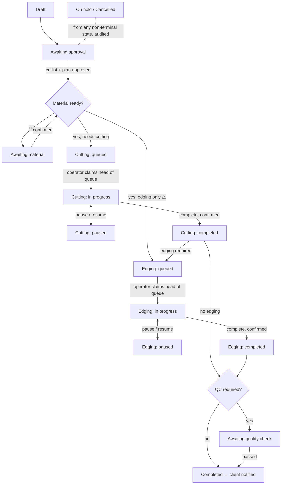
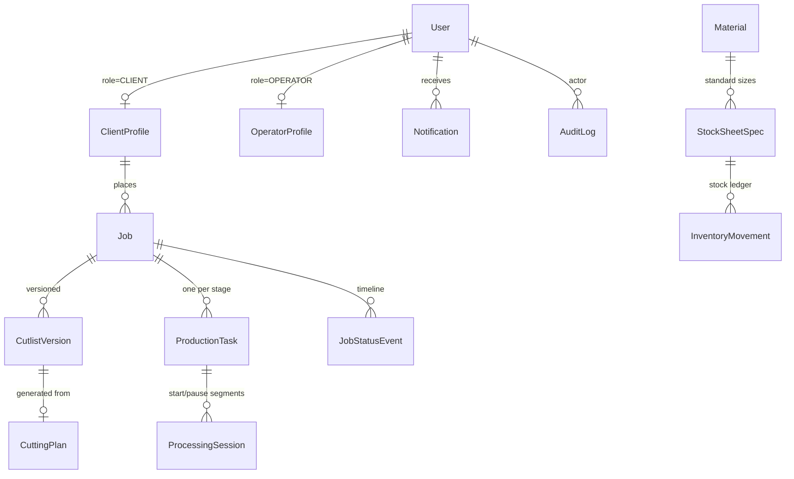

# Pacwoods — Phase 0: discovery and architecture

Status: draft for review, 2026-10-26. Nothing here is implemented yet except
the holding page. Items marked **DECISION NEEDED** block the phase named next
to them.

## 0. Repository findings

| Area | Finding |
| --- | --- |
| Framework | Next.js 16.3.1 (App Router), React 19.2.8, TypeScript 5 strict, Tailwind 4, Node 20.19 locally. Next 16 renames Middleware to **Proxy** (`src/proxy.ts`); Proxy is for optimistic redirects only, never the authorization layer. `@node-rs/argon2` is on Next's automatic `serverExternalPackages` list. |
| Previous content | The repo was the PottoFlip marketing site. All of it has been removed; the root route is now a Pacwoods holding page. |
| Dependencies | `framer-motion` removed (unused). The `shadcn` CLI was a runtime dependency only for one CSS import; that CSS is now vendored as `src/app/shadcn.css` and the CLI is run with `npx` when adding components. |
| Git history | **Resolved:** restarted as a single clean commit pushed to `github.com/odomaurice/pacwoods`; the old history is kept only on a local `potto-archive` branch. Previously: Earlier Potto commits contain ~108 MB of loose objects: `public/videos/intro-main.mp4` (31.9 MB), slide JPEGs of 6–12 MB, more videos and avatar photos. Remotes `origin` and `personal` still point at Potto repositories. See §7, item 1. |
| Brand | `docs/brand/logo-sample.jpeg` (photo of the sign). Palette sampled from it: charcoal `#1B2328`, gold `#D99E56`, steel `#E7E8EA`. The SVG mark is a redrawing, not the master artwork. |
| Cutlist reference screenshot | Supplied in chat (not stored in the repo). A mobile cutlist app: three collapsible sections, **Panels** and **Stock sheets** (spreadsheet grids: Length, Width, Qty, a label column and a row menu; a blank row is always waiting at the bottom; complete rows tint green, empty ones red) and **Options** (kerf thickness; labels on panels; use only one sheet from stock; consider material; edge banding; consider grain direction), plus a floating run button that generates the layout. Phase 3 keeps that flow and adds material, thickness, grain and per-edge banding per part, with validation messages instead of colour alone. |
| Spec vs. sign | The sign lists **CNC machining**; the spec covers only cutting and edging. See §7. |

### Version check (npm registry, 2026-10-26)

| Package | Current | Note |
| --- | --- | --- |
| prisma | 7.10.1 stable; 8.0.0-rc.27 tagged `latest` | Prisma 7 does **not** support MongoDB. Prisma's own guidance is to stay on 6.19 until Prisma 8 (RC) ships MongoDB support. |
| mongoose | 9.11.4 | Full MongoDB feature set. |
| next-auth | 4.24.15 stable; 5.0.0-beta.32 | Auth.js is maintained by the Better Auth team since Sept 2025 and is in security-patch mode; v5 never left beta. |
| @node-rs/argon2 | 2.2.2 | Prebuilt binaries, no node-gyp. |
| zod | 4.6.7 | |

---

## 1. Product requirements summary

Pacwoods runs a wood-processing workshop. Staff take a client's order, build a
cutlist of parts against stock sheets, generate a guillotine cutting plan, and
push the job through **cutting** and **edging** stages, each with its own FIFO
queue worked by qualified operators on the floor. Every job has a unique work
number (`PAC-2026-000001`), a QR code, an immutable timeline and an audit trail.
Clients sign in with provisioned credentials to watch their own jobs progress
from real events, with estimates clearly labelled as estimates.

Non-negotiables:

1. Queue order is enforced on the server and is concurrency-safe.
2. Edging never starts before required cutting completes.
3. Overall job status is derived from stage states, never set by hand.
4. Clients see only their own jobs, and never internal notes.
5. The cutting plan drawing is the algorithm's actual output, and unplaced
   parts are reported with a reason.
6. No fake data anywhere a user can see.

## 2. Role-permission matrix

✔ allowed · ◐ restricted (see note) · — not allowed

| Capability | Super Admin | Admin | Operator | Client |
| --- | :-: | :-: | :-: | :-: |
| Manage administrators | ✔ | — | — | — |
| Manage operators | ✔ | ◐ ¹ | — | — |
| Manage clients | ✔ | ✔ | — | — |
| Reset access / revoke sessions | ✔ | ◐ ² | — | — |
| Create and configure jobs and cutlists | ✔ | ✔ | — | — |
| Generate / regenerate a cutting plan (before production) | ✔ | ✔ | — | — |
| Approve a cutlist / plan | ✔ | ✔ | — | — |
| Revise an approved plan after production starts | ✔ ³ | ◐ ³ | request only | — |
| Assign and reassign operators | ✔ | ✔ | — | — |
| Manage materials, stock sheets, inventory | ✔ | ◐ ⁴ | — | — |
| System settings (kerf defaults, estimates, etc.) | ✔ | — | — | — |
| View all jobs and queues | ✔ | ✔ | own queue ⁵ | — |
| Start / pause / resume / complete a stage | — ⁶ | — ⁶ | ✔ eligible task only | — |
| Report issue / interruption | ✔ | ✔ | ✔ | — |
| Resolve exceptions (hold, cancel, reassign) | ✔ | ✔ audited | — | — |
| Generate QR, barcode, job cards, labels | ✔ | ✔ | print own task | own jobs |
| Exports (XLSX, CSV, PDF) | ✔ all | ✔ operational | own history | own jobs |
| Dashboards and reports | ✔ platform | ✔ daily ops | own stats | own jobs |
| Audit log | ✔ | ◐ job-level | — | — |
| View own jobs, timeline, documents | — | — | — | ✔ |
| Change own password | ✔ | ✔ | ✔ | ✔ |

1. Admins manage operators only if granted the `operators.manage` permission.
   Admins can never create or promote anyone to Super Admin or Admin.
2. Admins reset operator and client access only.
3. Requires a reason; creates a new plan version and an audit record. Whether a
   second approval is required is an open question (§7).
4. Proposed: Admins adjust stock levels; only Super Admin edits the catalogue.
5. Operators see the queue for the stages their capabilities cover, plus the
   job details needed for that stage. No pricing, no internal client notes.
6. Staff do not run stages for operators. If the business wants Admins able to
   record work on an operator's behalf, that is a separate audited action (§7).

## 3. Production workflow



⚠ The edging-only entry is unresolved; until it is decided, edging-only jobs are
not creatable.

### Two levels of status

**Stage status** (one per `ProductionTask`): `NOT_REQUIRED`, `BLOCKED`
(prerequisite unmet), `QUEUED`, `IN_PROGRESS`, `PAUSED`, `COMPLETED`,
`CANCELLED`.

**Job status** is *derived* by one pure function, `deriveJobStatus(job,
tasks)`, from the job's own gate fields (draft, approval, material readiness,
hold, cancellation, QC) and its task statuses. The derived value is stored on
the job for indexing, but only the transition service writes it, in the same
transaction as the task change and the timeline event.

| Job status | Derived when |
| --- | --- |
| Draft | not submitted |
| Awaiting Approval | submitted, plan not approved |
| Awaiting Material | approved, material not confirmed |
| Queued for Cutting | cutting `QUEUED` |
| Cutting in Progress | cutting `IN_PROGRESS` or `PAUSED` |
| Awaiting Edging | cutting `COMPLETED`, edging released but not yet queued (only if release is a manual step, §7) |
| Queued for Edging | edging `QUEUED` |
| Edging in Progress | edging `IN_PROGRESS` or `PAUSED` |
| Awaiting Quality Check | all required stages `COMPLETED`, QC required |
| Completed | all required stages done, QC passed or not required |
| On Hold / Cancelled | explicit audited action; overrides the above |

### Queue policy (proposed)

- One FIFO queue **per stage per workshop**. The queue order is a `queueSeq`
  from an atomic counter, assigned on entering `QUEUED` and never edited.
  Re-queueing after a hold keeps the original `queueSeq` unless an Admin
  explicitly sends it to the back, which is audited.
- A task may be **pre-assigned** to an operator or left **open**.
- Operator *O* may start task *T* only if *T* is the lowest-`queueSeq` `QUEUED`
  task in that stage that is either assigned to *O* or open, *O* holds the stage
  capability, *O* is active, and *O* has no other `IN_PROGRESS` task.
- Several operators can work in parallel (one machine each). Each takes the
  head of *their* eligible view of the queue. Whether this matches the floor
  is open (§7).

### Concurrency

Starting a task runs in a MongoDB transaction (Atlas is a replica set):

1. Load the operator and check active status and capability.
2. Find the head eligible task for this operator and require it to be the
   requested task. Otherwise return `NOT_HEAD_OF_QUEUE` with the blocking job.
3. `updateOne({ _id, status: "QUEUED", version }, { $set: { status:
   "IN_PROGRESS", operatorId, ... }, $inc: { version: 1 } })`. Zero matches
   means someone else won, so return `ALREADY_STARTED`.
4. Insert the `ProcessingSession`, the `JobStatusEvent` and the `AuditLog`
   entries, and update the derived job status, all in the same transaction.

Backstops: a **partial unique index** on `productionTasks { operatorId: 1 }`
where `status: "IN_PROGRESS"` (one active task per operator), and MongoDB
write-conflict aborts between concurrent transactions. Tests fire concurrent
starts at the real database (§9).

### Timing

Each start/resume opens a `ProcessingSession` segment and each pause/complete
closes it. *Active duration* = Σ segments; *paused duration* = gaps;
*elapsed* = completion − first start. A **stop** without completion always
leaves the task `PAUSED` with a required reason. It is never treated as done.

## 4. Domain model

Mongo-shaped: documents own what they contain, and references are used where
data has an independent lifecycle or grows without bound.



| Collection | Key fields | Embedded | Indexes |
| --- | --- | --- | --- |
| `users` | role (`SUPER_ADMIN`/`ADMIN`/`OPERATOR`/`CLIENT`), permissions[], name, phoneE164?, email?, passwordHash, mustChangePassword, status (`ACTIVE`/`SUSPENDED`/`DEACTIVATED`), sessionVersion, failedLogins, lockedUntil | — | unique partial `phoneE164`, unique partial `email` (only where present, so many phone-only clients without email are allowed) |
| `clientProfiles` | userId, clientNumber (`PCL-000001`), businessName, address?, staffNotes (never sent to clients) | — | unique `clientNumber`, unique `userId` |
| `operatorProfiles` | userId, capabilities[`CUTTING`,`EDGING`], workshopId | — | `capabilities` |
| `jobs` | workNumber, clientId, workshopId, operations{cutting, edging}, gates{submittedAt, approvedPlanId, materialConfirmedAt, holdReason, cancelledAt, qcRequired, qcPassedAt}, status (derived), estimates[] (history), qrToken, notes{client, internal} | estimates history | unique `workNumber`, unique `qrToken`, `{clientId, createdAt}`, `{status, createdAt}` |
| `cutlistVersions` | jobId, version, parts[], stockSheets[], options{kerf, rotation, grainRules, edgeTrim}, state (`DRAFT`/`APPROVED`/`SUPERSEDED`), approvedBy/At, revisionReason | parts (name, L, W, qty, materialId, thickness, grain, edges{top,bottom,left,right → edgeBandId?}), stock sheet rows | unique `{jobId, version}` |
| `cuttingPlans` | cutlistVersionId, engineVersion, inputHash, sheets[], unplaced[], totals | sheets → placements (partRef, x, y, w, h, rotated, cut sequence), offcuts | `cutlistVersionId` |
| `productionTasks` | jobId, stage (`CUTTING`/`EDGING`), status, queueSeq, workshopId, assignedOperatorId?, operatorId?, prerequisiteTaskId?, results{qtyDone, waste, defects, downtimeMin, notes}, version | — | `{workshopId, stage, status, queueSeq}`, partial unique `{operatorId}` where `IN_PROGRESS`, unique `{jobId, stage}` |
| `processingSessions` | taskId, operatorId, startedAt, endedAt?, endReason (`PAUSE`/`COMPLETE`/`INTERRUPTION`/`REASSIGN`), interruptionReason? | — | `{taskId, startedAt}` |
| `jobStatusEvents` | jobId, taskId?, type, from, to, actorId, at, note, reason, clientVisible | — | `{jobId, at}`; append-only |
| `materials` | name, category, type, thickness, grain (`NONE`/`LENGTHWISE`), supplier?, unitCost?, active | standard sheet sizes | `{active, category}` |
| `inventoryMovements` | stockSpecId, delta, kind (`RECEIVE`/`RESERVE`/`RELEASE`/`CONSUME`/`OFFCUT_RETURN`/`ADJUST`), jobId?, actorId, reason | — | `{stockSpecId, at}`; stock level = Σ delta (ledger, no mutable counter as the source of truth) |
| `notifications` | userId, kind, jobId?, title, body, readAt?, channel | — | `{userId, readAt, createdAt}` |
| `auditLogs` | actorId, action, target{type,id}, before?, after?, ip, at | — | `{target.id, at}`, `{actorId, at}`; append-only |
| `counters` | `_id` (e.g. `job:2026`, `client`), seq | — | — (atomic `findOneAndUpdate` + `$inc` + upsert) |
| `settings` | key, value, updatedBy | — | unique `key` |
| `authThrottle` | key (ip/identifier), count, windowStart | — | TTL index (rate limiting without Redis) |
| `passwordResetTokens` | userId, tokenHash, expiresAt, usedAt? | — | TTL on `expiresAt` |

Decisions in the model:

- **One job = one client order.** Parts of different materials stay in one job;
  the cutting engine partitions them by material + thickness and the plan shows
  each group's sheets separately. One `ProductionTask` per stage per job. If
  different materials go to different machines or teams, tasks will be split
  per material group instead (§7).
- **Cutlists are versioned and immutable once approved.** A revision creates a
  new version; production and exports reference the exact `cutlistVersionId`.
- **Deletion:** users are deactivated, never deleted, while they are referenced.
  Events, sessions, audits and inventory movements are append-only. Retention
  periods are open (§7).

## 5. Folder structure (proposed)

```
src/
  proxy.ts                      # optimistic redirects only (Next 16 "Proxy")
  app/
    (public)/login, reset-password, change-password, denied
    (staff)/                    # shell with role navigation
      overview/ admins/ operators/ clients/ jobs/[workNumber]/
      jobs/[workNumber]/cutlist/ jobs/[workNumber]/plan/
      queues/cutting/ queues/edging/ materials/ inventory/
      reports/ audit/ notifications/ settings/
    (operator)/queue/ task/[taskId]/ history/ report-issue/
    (client)/dashboard/ jobs/[workNumber]/ documents/ profile/ notifications/
    api/exports/…  api/qr/…     # route handlers for files
    not-found.tsx
  components/ui/                # shadcn primitives
  components/                   # app components (StatusBadge, Timeline, PlanSvg…)
  lib/
    cutting/                    # pure TS engine: no I/O, fully unit-tested
    estimates/                  # pure duration formulas
    csv.ts, ids.ts, units.ts
  server/                       # server-only modules ("server-only" import)
    db/ (connection, models)    # one ORM/ODM, see ADR
    auth/ (config, session, guards: requireRole, requireCapability, requireOwnClient)
    workflow/ (transitions.ts, deriveJobStatus.ts, queue.ts)
    services/ (users, jobs, cutlists, inventory, notifications, audit)
    exports/ (xlsx, pdf)
  actions/                      # server actions: validate (zod) → guard → service
tests/
  unit/ integration/ e2e/
```

The role route groups map to one guard per layout, but **every** server action
and route handler calls its own guard as well. Layouts are not a security
boundary.

## 6. Architecture decision record

### ADR-1 Database layer: Mongoose 9, not Prisma — **ACCEPTED 2026-10-26**

*Context.* The spec prefers Prisma if it supports everything. As of
2026-10-26, Prisma 7 (the current stable line) does not support MongoDB.
Prisma's guidance is to use 6.19 until Prisma 8, now a release candidate, adds it.

*Requirements that stress the choice:*

| Need | Prisma 6 + MongoDB | Mongoose 9 |
| --- | --- | --- |
| Conditional compare-and-set update | `updateMany` with filter (works, returns count) | `updateOne` / `findOneAndUpdate` |
| Atomic counter for work numbers | needs `$runCommandRaw` findAndModify | native `findOneAndUpdate` `$inc` upsert |
| Partial unique index (optional email/phone) | not expressible in schema; manual script | `partialFilterExpression` in schema |
| TTL indexes (tokens, throttle) | not expressible; manual | native |
| Transactions | supported (replica set) | supported |
| Migrations | none for MongoDB (`db push`) | none (schema in code) |
| Long-term support | legacy 6.x line, upgrade to 8 later | current major |

*Recommendation.* **Mongoose 9**, as the only data layer. Prisma 6 would put the
project on a superseded line on day one and force a migration to 8. Several
core guarantees (counters, partial unique indexes, TTL) would bypass Prisma's
schema anyway. The cost is weaker generated types; we mitigate it with typed
schemas, `InferSchemaType`, and Zod at every boundary.

*Alternative if you want to stay on Prisma:* Prisma 6.19 now, Prisma 8 later,
with a raw-command module for the counter and a setup script for the indexes.

### ADR-2 Authentication: Auth.js v5 Credentials + JWT with a server check — **ACCEPTED 2026-10-26**

*Context.* The spec asks for NextAuth/Auth.js. v5 is the App Router version but
has stayed `beta` and is in security-maintenance mode under the Better Auth
team. Credentials sign-in in Auth.js cannot use database sessions, so sessions
are JWTs.

*Design.* Credentials provider (phone or email + password), Argon2id via
`@node-rs/argon2`. The JWT carries `userId` and `sessionVersion`. Every
server-side `auth()` call re-reads the user (cached per request) and rejects
the session if the user is suspended or `sessionVersion` changed. That gives
immediate suspension and "revoke all sessions". No database adapter is needed.
Rate limiting is stored in Mongo (`authThrottle`) with per-account lockout.
Password reset uses hashed, single-use tokens that expire in 30 minutes. Clients
without email get an Admin reset (§7). Server actions get Next's built-in
origin check against CSRF, and Auth.js has its own CSRF token for its routes.

*Alternative.* **Better Auth**: actively developed, with database sessions
(real revocation), rate limiting and phone-number sign-in built in. It deviates
from the requested stack, so it needs your approval.

*Recommendation.* Auth.js v5 as specified, unless you prefer a library that is
not in maintenance mode. In that case use Better Auth.

### ADR-3 MongoDB Atlas

Atlas replica set, which multi-document transactions require. Connection string
in `MONGODB_URI` only. Separate databases for dev, test and prod. Atlas
continuous backup on prod. Indexes are declared in schemas and synced by a
`db:indexes` script in CI/deploy.

### ADR-4 Cutting optimisation

- **Engine:** pure TypeScript in `src/lib/cutting`. Deterministic, no I/O,
  versioned (`engineVersion` stored with every plan).
- **Algorithm:** guillotine bin-packing heuristic. For each material +
  thickness group, run several strategies (sort by area / longest side /
  perimeter × best-short-side / best-area fit × split shorter/longer
  leftover axis). Keep the plan with the fewest sheets, then the least waste.
  Kerf is reserved on every split. Edge trim is subtracted from each sheet
  first. Rotation is allowed only when grain permits (part grain `NONE`, or
  sheet grain `NONE`).
- **Honesty:** labelled *"optimised by heuristic — not guaranteed minimal"*.
  The plan reports sheet count, utilisation, and a lower bound (Σ part area ÷
  sheet area) so the gap is visible.
- **Validation (always run, also in prod):** every placement within the trimmed
  sheet, no overlaps including kerf, quantities reconciled, and each unplaced
  part gets a reason (`LARGER_THAN_SHEET`, `GRAIN_PREVENTS_ROTATION`,
  `NO_COMPATIBLE_STOCK`, `STOCK_EXHAUSTED`).
- **Cut sequence:** derived from the guillotine split tree, so the drawn
  sequence is the real one.
- **Rendering:** custom SVG from the plan document (no canvas library), with
  zoom/pan and identical geometry in the PDF export.

### ADR-5 Supporting libraries (to confirm at install time)

| Need | Choice | Why |
| --- | --- | --- |
| QR generation | `qrcode` | small, server-side SVG/PNG |
| Barcode (Code 128) | `bwip-js` | server-side SVG |
| Camera scanning | native `BarcodeDetector`, falling back to `@zxing/browser` (lazy-loaded) | keeps the bundle small on supported devices |
| XLSX | `exceljs` | maintained on npm; the npm SheetJS build is outdated |
| CSV | in-house RFC 4180 writer (~30 lines, tested), with formula-injection guard | no dependency needed |
| PDF | `@react-pdf/renderer` in route handlers | reuses the SVG plan geometry |
| Charts | shadcn charts (Recharts) | matches the UI kit |
| Forms | React Hook Form + Zod | as specified |
| Server state | TanStack Query **only** for the live operator queue / dashboards if polling is needed; elsewhere Server Components + `router.refresh()` | avoids a second cache by default |
| Tests | Vitest, Playwright | |

Heavy packages (`@react-pdf/renderer`, `exceljs`, `@zxing/browser`) are
server-only or lazy-loaded so they stay out of the main client bundle.

## 7. Unresolved business rules

1. ~~Git history and remotes~~ — resolved: fresh history, remote
   `github.com/odomaurice/pacwoods`.
2. **Edging compensation:** are part dimensions entered as finished sizes? If
   so, is edge-band thickness subtracted from the cut size, and per which
   edge-band product?
3. **Edging-only jobs:** allowed? If yes, does the client bring pre-cut parts,
   and who confirms material readiness?
4. **FIFO scope:** how many workshops/sites? How many cutting machines and
   edgebanders run in parallel? Is "pre-assign or open claim" (§3) how the floor
   works?
5. **Release to edging:** automatic on cutting completion, or a manual hand-off
   (parts physically moved)?
6. **Quality check:** required for every job, some jobs, or none? Who performs it?
7. **Inventory at launch:** track stock levels from day one, or just a
   "material confirmed" checkbox? Are usable offcuts returned to stock, and what
   is the minimum usable offcut size?
8. **Cutting defaults:** blade kerf (e.g. 3–4.4 mm), sheet edge trim,
   millimetres only?
9. **Grain convention:** does grain run along the sheet's length? May a part
   with grain ever be rotated?
10. **Estimation inputs:** setup time per sheet, time per cut, edgebander speed
    (m/min), per machine.
11. **Disclosure to clients:** may clients see operator names, or only "Cutting
    team"? Which delay reasons are client-visible?
12. **Temporary password hand-over:** printed slip at the counter, SMS (which
    provider?), WhatsApp, or email? How do phone-only clients reset a forgotten
    password: Admin reset only, or SMS OTP?
13. **CNC machining** appears on the sign but not in the spec. Is it in scope, as
    a third stage?
14. **Plan revisions after production starts:** does a revision need a second
    approver? Can a job be cancelled after cutting has started, and what happens
    to consumed stock?
15. **Admins recording work for operators:** ever allowed (e.g. operator
    without a device)?
16. **Locale:** time zone, currency for material costs, phone-number country
    default.
17. **Retention:** how long are completed jobs, audit logs and client data kept?
18. **Work numbers:** does the sequence restart each year (`PAC-2027-000001`)?
    Proposed: yes.
19. ~~Cutlist reference screenshot~~ — supplied; notes in §0.

## 8. Implementation checklist

**Phase 0 (this document)**: repository inspected · rebrand · heavy deps
removed · ADRs drafted · ADR-1 (Mongoose) and ADR-2 (Auth.js v5) accepted · ☐ §7 items 2–9.

**Phase 1 (foundation):** ✔ Mongoose connection + index sync ✔ `.env.example`
✔ auth (credentials, Argon2id, sessionVersion re-check, IP + account throttle)
✔ forced password change ✔ guards (`requireUser`, `requireRole`) ✔ `proxy.ts`
redirects ✔ shadcn/ui + Hugeicons ✔ role shells ✔ Vitest + test database ✔
Super Admin bootstrap script · ☐ `requireCapability` / `requireOwnClient`
(arrive with jobs, Phase 2–4) ☐ Playwright ☐ CI.

**Phase 2 (users and jobs):** ☐ user provisioning per role with temp passwords
☐ suspend/deactivate/revoke ☐ client numbers + printable client card ☐ work
number counter ☐ job create/edit ☐ material catalogue ☐ audit log service.

**Phase 3 (cutlist):** ☐ cutlist editor (parts, stock, options, edges) ☐ engine
+ validators + property tests ☐ SVG plan viewer ☐ calculations + estimates ☐
versioning, approval, revision lock.

**Phase 4 (production):** ☐ tasks + queueSeq ☐ eligibility + head-of-queue
check ☐ start/pause/resume/complete/interrupt with confirmations ☐ concurrency
(transaction + partial unique index) ☐ reassignment ☐ timeline events ☐
`deriveJobStatus`.

**Phase 5 (clients):** ☐ client dashboard ☐ progress tracker with N/A stages
☐ estimates history ☐ notifications (in-app; channel interface for SMS/email).

**Phase 6 (QR and exports):** ☐ QR (opaque token) + barcode ☐ scanner + manual
lookup ☐ job card, labels, client card ☐ PDF job sheet + layout ☐ XLSX/CSV
cutlist ☐ export authorization tests.

**Phase 7 (dashboards):** ☐ Super Admin, Admin, Operator, Client dashboards
from aggregations ☐ filters ☐ material usage and waste reports.

**Phase 8 (release):** ☐ full acceptance run (spec §22) ☐ mobile pass on real
devices ☐ load/concurrency test on Atlas ☐ deployment, backup and restore docs.

## 9. Testing strategy

| Layer | Tool | What it proves |
| --- | --- | --- |
| Unit (pure) | Vitest | Cutting engine: property-based tests (random parts and sheets → no overlap, in bounds, kerf respected, grain respected, qty reconciled, every unplaced part has a reason); golden fixtures for known layouts; estimate formulas; `deriveJobStatus` over every stage combination; CSV escaping and formula injection; work-number formatting. |
| Integration | Vitest against a real MongoDB replica set (local `mongod --replSet` or a dedicated Atlas test DB) | Transition service: every allowed and forbidden transition; head-of-queue enforcement; **N concurrent start requests → exactly one succeeds**; operator with both capabilities cannot edge before cutting completes; cutting-only jobs complete without edging; reassignment keeps sessions; suspended user rejected mid-session; counter uniqueness under concurrency. |
| Authorization | Vitest, table-driven | Every server action and route handler × every role × own/other resource → expected allow/deny. Client A can never read client B's job, export or QR target. |
| End-to-end | Playwright (desktop + mobile viewports) | Spec §22 acceptance scenarios 1–24 as scripted flows, including confirmation dialogs, URL tampering to start a later task, and file downloads checked for content. |
| Manual | Real phones on the floor | QR scanning, glove-friendly targets, print output of job cards and labels. |

Every phase ends with lint, build, the test suite, and a short report of what
changed, test results, and known limitations.
